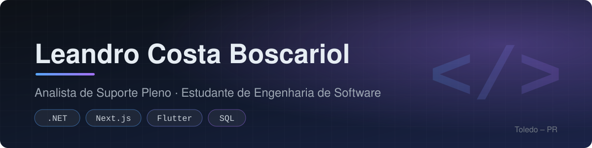

  

  
  
  

## 👋 Sobre mim

- 🛠️ Analista de Suporte Pleno na **Inside Sistemas**: sustentação de ERP, investigação de incidentes, análise de logs e consultas SQL
- 🎓 Estudante de **Engenharia de Software** na Faculdade Donaduzzi (Biopark, 2024–2027)
- 💻 Desenvolvo projetos full stack com .NET, Node.js, Next.js e Flutter
- 🔬 Pesquiso segurança em agentes de IA: apresentei na II Conferência de IA – IA 360° (2026)

## 🧰 Tecnologias

  

## 🚀 Projetos em destaque

| | Projeto | O que é | Stack |
| :---: | --- | --- | --- |
| 🏢 | [**CondoGest**](https://github.com/LeandroCostaB/CondoGest) | Gestão de condomínios: 3 microsserviços, painel web do síndico e app mobile com notificações push | NestJS · Next.js · Flutter · PostgreSQL · RabbitMQ · Docker |
| 📈 | [**Chronos Forecast**](https://github.com/LeandroCostaB/fastapi-chronos-forecast) | API de previsão de séries temporais com o modelo Amazon Chronos e dashboard interativo | Python · FastAPI · PyTorch · Streamlit |
| 📅 | **Scheduling SaaS** *(privado)* | SaaS multi-tenant de agendamentos para barbearias, salões e clínicas, com página pública de reserva | C# · .NET · EF Core · PostgreSQL · Next.js |

## 🔬 Pesquisa

> **Da Execução Autônoma ao Risco Estrutural: Desafios de Segurança na Era da Agentic AI**
> Banner apresentado na II Conferência de Inteligência Artificial – IA 360° (2026), com orientação da Prof. Me. Letícia Siguinolfi.
